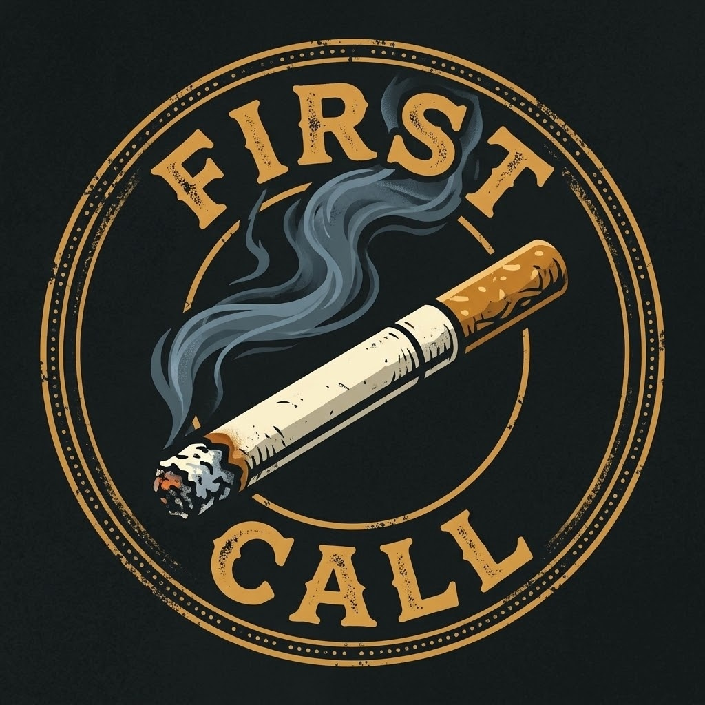

# Vesper ritual — digital cigarette ritual

Vesper Ritual is an atmospheric, tactile, first-person web application designed
to support smoking reduction by recreating the sensory hand-to-mouth ritual in a
private digital space.



---

## Overview

Smoking is as much a behavioral and sensory ritual as a chemical habit. The
physical pause, the hand-to-mouth motion, the glowing ember, and the rhythmic
inhalation form a deeply ingrained routine. Vesper Ritual gives adult smokers a
controlled digital replacement for this tactile ritual without tobacco, smoke,
carbon monoxide, or combustion.

The application loads directly into an interactive, real-time 3D retro Dhaka
street scene on the starting page. Everything fits within a single viewport with
zero scrolling, featuring a refractive glass user interface, authentic brand
packs, and live atmospheric controls.

### Key highlights

- **Real-time 3D Dhaka street scene**: Fully interactive Three.js environment
  featuring roadside tea stalls ("চায়ের টং"), cycle rickshaws, green CNGs,
  weathered concrete architecture, overhead utility wires, and dynamic lighting.
- **Single-screen refractive glass UI**: A compact starting page layout with
  frosted, semi-transparent buttons and zero scrolling.
- **Nine authentic brand packs**: Includes Benson & Hedges, Marlboro Red,
  Marlboro Gold, Navy, Star, Sheikh, Lucky Strike, Camel Connect, and Dunhill
  with high-resolution cutout artwork.
- **Centered first-person viewmodel**: Realistic stationary cigarette viewmodel
  positioned at center screen with responsive lighting, live burn progression,
  and dynamic radial ember flare.
- **Natural, unlocked cursor look-around**: An always-visible mouse cursor with
  smooth drag rotation and no pointer lock interruptions.
- **Dynamic weather switching**: Seamlessly toggle between rain, clear night,
  and dense fog with live particle adjustments and procedural soundscapes.
- **Six or seven discrete draws**: Manually controlled interactive draws
  simulating the exact duration of a traditional smoking break.
- **Zero-dependency Web Audio engine**: Procedural sound synthesis for lighter
  flicks, air intake, tobacco leaf crackle, rain, wind, and harmonic chimes.
- **Private, anonymous progress tracking**: Self-reported baseline management,
  real versus digital cigarette comparisons, avoided cigarette estimations,
  and local JSON export without external servers or accounts.

---

## Features

### 1. Starting page and glass ritual controls

Vesper Ritual greets you with a full-viewport 3D scene overlaid with a modern
frosted glass control panel. You can select your preferred cigarette brand,
adjust the weather, select draw cadence, and light the cigarette directly from
the opening screen.

- Single-screen responsive layout constrained to 100% dynamic viewport height.
- Nine semi-transparent brand buttons displaying authentic pack artwork.
- Weather toggles for rain, clear evening, and midnight fog.
- Ritual cadence toggles for 7 draws (classic) or 6 draws (mindful).
- Instant ignition with the glowing **LIGHT CIGARETTE** trigger.

### 2. Authentic brand humidor

Choose from nine recognizable brands, each configured with specific filter
tones, paper wraps, ember temperatures, and draw profiles:

- **Benson & Hedges**: Golden cork filter with a balanced draw.
- **Marlboro Red**: Traditional cork tip with a dense, robust crackle.
- **Marlboro Gold**: Bright golden band with a smooth draw.
- **Navy**: Deep blue accent band with an oceanic, crisp draw profile.
- **Star**: Classic vintage red star motif with an intense burn.
- **Sheikh**: Deep crimson band with a rich, full-bodied crackle.
- **Lucky Strike**: Heritage toasted circle crest with a warm amber burn.
- **Camel Connect**: Turkish and domestic blend profile with an amber glow.
- **Dunhill**: Elegant silver crest with a slow, refined combustion rate.

### 3. Tactile 3D first-person scene and state machine

The ritual follows an immutable finite state machine (`idle` → `lighting` →
`ready` → `inhaling` → `recovering` → `completed` / `paused`).

- Centered first-person cigarette viewmodel positioned naturally on screen.
- Dynamic radial ember flare that blooms from warm crimson to white-hot heat
  during active draws.
- In-memory procedural canvas smoke particle system with physical buoyancy,
  drag, and dispersion.
- Unlocked mouse cursor letting you interact with UI controls or drag to look
  around the street without capturing the pointer.
- Automatic pause when switching browser tabs via the Page Visibility API.
- Rejection of rapid double-clicks and accidental keystrokes during draws.

### 4. Progress and harm reduction dashboard

Track your reduction journey locally and privately:

- Daily baseline editor (cigarettes smoked per day and pack pricing).
- One-click logging for real cigarettes smoked.
- Seven-day visual comparison bar chart.
- Calculation of estimated cigarettes avoided and total money saved.
- Offline local JSON data export, import, and permanent wipe tools.

---

## Screenshots

| 3D Dhaka street scene | Refractive glass UI controls |
| :---: | :---: |
|  |  |

---

## Prerequisites

- **Node.js**: v18.17.0 or higher (tested on Node.js v20.x and v22.x)
- **npm**: v9.0.0 or higher (or pnpm / yarn)

---

## Quickstart

### 1. Clone and install

```bash
git clone <repository-url>
cd "virtual cigs"
npm install
```

### 2. Run locally in development

```bash
npm run dev
```

Open [http://localhost:3000](http://localhost:3000) in your web browser.

### 3. Run automated tests

```bash
npm run test
```

### 4. Build for production

```bash
npm run build
npm run start
```

---

## Environment variables

The application runs entirely on the client side with zero mandatory external
secrets. For custom hostnames, review `.env.example`:

```bash
NEXT_PUBLIC_APP_URL=http://localhost:3000
```

---

## Free-tier deployment (Vercel)

This application is optimized for zero-cost static hosting on Vercel:

1. Push your repository to GitHub.
2. Sign in to [Vercel](https://vercel.com) using your GitHub account.
3. Import the `vesper-ritual` repository.
4. Leave build settings as default (`npm run build`).
5. Click **Deploy**.

The project requires no external databases, serverless compute functions, or
paid third-party subscriptions.

---

## Known limitations and design decisions

- **Browser Web Audio autoplay policy**: Modern browsers require an initial
  user interaction (tap, click, or key press) before outputting audio. The app
  resumes the audio context seamlessly on your first click.
- **Harm reduction positioning**: Vesper Ritual is a mindful tactile simulation
  tool. It does not make medical claims and does not replace clinical smoking
  cessation therapy.
- **Viewmodel focus**: Hand meshes are hidden in favor of a centered, crisp
  3D cigarette model to provide an unobtrusive first-person perspective.

---

## Documentation index

- [`GEMINI.md`](GEMINI.md): Agent system instructions and coding invariants.
- [`docs/PRD.md`](docs/PRD.md): Product requirements document.
- [`docs/ARCHITECTURE.md`](docs/ARCHITECTURE.md): System architecture.
- [`docs/IMPLEMENTATION_PLAN.md`](docs/IMPLEMENTATION_PLAN.md): Completed
  milestones.
- [`docs/ASSET_GUIDE.md`](docs/ASSET_GUIDE.md): Asset specifications.
- [`docs/ASSET_MANIFEST.md`](docs/ASSET_MANIFEST.md): Inventory and licensing.
- [`docs/SCENE_EDITING_GUIDE.md`](docs/SCENE_EDITING_GUIDE.md): 3D scene
  configuration guide.
- [`docs/GRAPHICS_DIRECTION.md`](docs/GRAPHICS_DIRECTION.md): Visual direction.
- [`docs/GRAPHICS_PERFORMANCE.md`](docs/GRAPHICS_PERFORMANCE.md): Optimization
  standards.
- [`docs/TESTING.md`](docs/TESTING.md): Testing matrix and verification suite.
- [`docs/DEPLOYMENT.md`](docs/DEPLOYMENT.md): Production hosting guide.
- [`docs/DECISIONS.md`](docs/DECISIONS.md): Architectural decision records.
