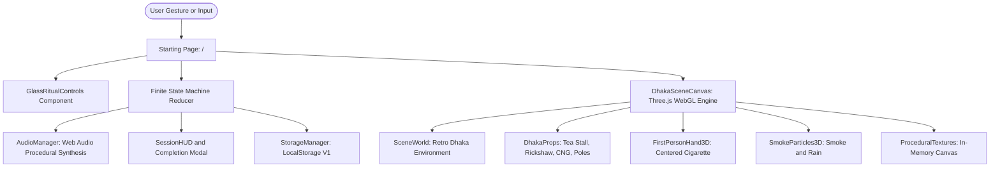
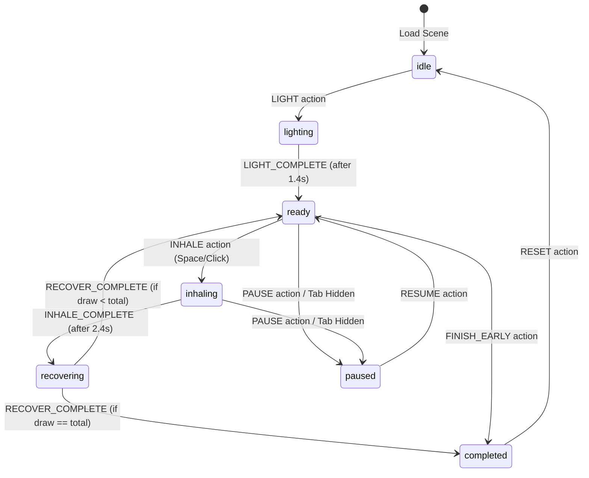

# System architecture: Vesper Ritual

This document outlines the software architecture, component relationships, 3D
graphics pipeline, finite state machine, procedural audio synthesis, and data
persistence patterns for Vesper Ritual.

## High-level architecture overview

Vesper Ritual is structured as a client-first, zero-backend web application
built on the Next.js 14 App Router. It combines declarative React components
with an imperative Three.js WebGL rendering pipeline, custom particle engines,
and procedural Web Audio API synthesis.



---

## Finite state machine (FSM)

The session lifecycle is governed by an explicit, deterministic reducer
function located in `src/features/session/sessionStateMachine.ts`. Every ritual
interaction must dispatch through this reducer.

### State diagram

The following state machine governs all user actions and visual feedback:



### Invariants and guard conditions

The finite state machine enforces three primary invariants:

- **Input locking**: While in `lighting`, `inhaling`, or `recovering` states,
  any duplicate click, tap, or spacebar inputs are strictly ignored to prevent
  desynchronization.
- **Draw counter**: The `currentDraw` counter increments only upon firing the
  `RECOVER_COMPLETE` transition.
- **Visibility protection**: When the browser fires a `visibilitychange` event
  with `document.hidden = true`, the session enters `paused` to protect state
  consistency.

---

## Real-time 3D scene architecture and rendering pipeline

The visual core of Vesper Ritual is an interactive real-time 3D WebGL
environment powered by Three.js. It replaces static photographic layering with
an authentic retro nighttime street scene set in Dhaka, Bangladesh.

### Component breakdown

The 3D engine is divided into five modular systems:

1. **`DhakaSceneCanvas.tsx`**: The top-level React wrapper. Manages the
   lifecycle of the `THREE.WebGLRenderer`, viewport resize listeners, the
   animation loop, and mouse drag rotation without capturing pointer lock. It
   uses standard `cursor-default` pointer styling.
2. **`SceneWorld.ts`**: Assembles the ambient scene hierarchy. Configures the
   sodium-vapor streetlamps, moonlit directional shadows, asphalt road surface,
   concrete sidewalk curbs, and multi-story concrete buildings.
3. **`DhakaProps.ts`**: Generates procedural compound 3D meshes for cultural
   and architectural anchors, including the tea stall ("চায়ের টং"), cycle
   rickshaw, green CNG auto-rickshaw, utility poles, and hanging catenary
   wires.
4. **`FirstPersonHand3D.ts`**: Constructs the camera-attached first-person
   viewmodel. Positions the 3D cigarette at center screen (`Y ≈ 50%–55%`,
   `X ≈ 50%–52%`), manages cork filter and paper wrap textures, and animates
   the dynamic radial ember heat light during active inhalation.
5. **`SmokeParticles3D.ts`**: Implements high-performance particle systems.
   Computes physical buoyancy, wind turbulence, and alpha dissipation for rising
   smoke using `THREE.Points`. Simulates falling nighttime rain streaks using
   `THREE.LineSegments`.
6. **`ProceduralTextures.ts`**: Renders all signboards, rickshaw folk art,
   wet asphalt road markings, and corrugated tin roof textures onto HTML5 2D
   canvases at startup. This eliminates external image network downloads and
   guarantees instantaneous rendering.

### Dynamic WebGL client boundary pattern

Because Three.js depends directly on browser `window`, `document`, and WebGL
contexts, any page importing the 3D canvas must use Next.js dynamic imports
with server-side rendering disabled:

```typescript
const DhakaSceneCanvas = dynamic(
  () =>
    import("@/components/immersive-scene/DhakaSceneCanvas").then(
      (mod) => mod.DhakaSceneCanvas
    ),
  { ssr: false }
);
```

---

## Starting page and glass ritual UI architecture

The application root (`/`) serves as both the landing exploration hub and the
immediate interactive ritual scene.

### Single-screen layout

The starting page is constrained to 100% dynamic viewport height (`h-[100dvh]`,
`overflow-hidden`) with zero scrolling. The 3D canvas occupies the entire
background, while the Refractive Glass UI overlay floats at the bottom of the
screen.

### Glass ritual controls

The `GlassRitualControls` component provides:

- **Nine-pack brand selector**: Semi-transparent frosted buttons displaying
  authentic brand pack artwork cutouts from `/assets/brands/`.
- **Atmosphere controls**: Instant toggles for Rain, Clear, and Fog weather
  presets.
- **Cadence switch**: Toggle between 7 Draws (Classic) and 6 Draws (Mindful).
- **Reactive state passing**: Brand and atmosphere selections are forwarded
  directly to the active 3D canvas through imperative ref handles without
  reinitializing the WebGL renderer.
- **Direct ignition trigger**: The glowing **LIGHT CIGARETTE** button initiates
  the session state machine immediately from the opening view.

---

## Web Audio engine and procedural synthesis

`AudioManager` (`src/features/audio/audioManager.ts`) implements pure procedural
sound synthesis using the Web Audio API, avoiding external audio file
dependencies:

- **Lighter flick**: A rapid square-wave pitch drop combined with a bandpass
  filtered white noise burst.
- **Inhale draw**: A sweeping biquad bandpass filter (320Hz to 750Hz) modulated
  by stochastic Brownian noise to simulate leaf combustion.
- **Exhale release**: Lowpass filtered pink noise fading out smoothly over 1.6
  seconds.
- **Randomized draw playback**: Six loudness-normalized audio clips
  (`/assets/audio/draw_1.mp3` through `draw_6.mp3`) cached in memory as decoded
  `AudioBuffer` nodes, selected with non-repeating random indices after every
  draw.
- **Brand selection click**: A tactile mechanical switch transient combining a
  sharp sine sweep (2600Hz to 500Hz), a bandpassed micro-noise burst (3600Hz),
  and a low chassis resonance (220Hz to 80Hz).
- **Ambient soundscapes**: Continuous noise buffers synthesizing rain on tin,
  night breeze, or humid city air.
- **Harmonic chime**: A tri-tone chord (440Hz, 554.37Hz, and 659.25Hz) with
  exponential natural decay to signal completion.

---

## Storage architecture and versioning

All user state is stored on the client side in `localStorage` under the key
`vesper_ritual_storage_v1`, validated through Zod schemas:

```typescript
interface StorageDataV1 {
  version: 1;
  baseline: UserBaseline;
  entries: Record<string, DailyLogEntry>; // YYYY-MM-DD
  preferences: UserPreferences;
}
```

The storage layer provides:

- **Automatic repair**: If stored data becomes corrupted, `StorageManager`
  safely falls back to valid defaults without crashing.
- **Multi-tab reactivity**: Writes trigger a custom `vesper-storage-update`
  window event to synchronize open browser tabs.
- **Total privacy**: Zero user habit data is sent to external servers.

---

## Communal user database and top 1000 leaderboard

A persistent atomic database (`src/lib/db/database.ts`) stores registered
participants and recorded cigarette burns in `data/database.json`:

```typescript
export interface UserRecord {
  id: string;
  name: string;
  normalizedName: string;
  createdAt: string;
  totalBurnt: number;
  brandStats: Record<string, number>;
  lastActive: string;
}
```

The system provides:

- **Strict handle validation**: Names must contain only English letters,
  numbers, and `@`, `#`, `$`, or `_` symbols, with no spaces (`/^[a-zA-Z0-9@#$_]+$/`).
- **Case-insensitive uniqueness**: Prevents duplicate handles while preserving
  the participant's original capitalization.
- **REST API routes**:
  - `GET /api/users?name=...` and `POST /api/users`: Handle lookup and creation.
  - `POST /api/burns`: Increments burnt count and brand distribution upon
    ritual completion.
  - `GET /api/leaderboard?limit=1000`: Computes sorted rankings for the top
    1,000 smokers.

---

## Future backend integration (Supabase ready)

The local storage interface is intentionally decoupled. To introduce optional
cloud synchronization in a future release:

1. Replace `StorageManager` calls with a Supabase client service.
2. Configure Row-Level Security (RLS) on `user_baseline` and `daily_logs`
   tables keyed by `auth.uid()`.
3. Implement an offline-first caching layer using Service Workers.
