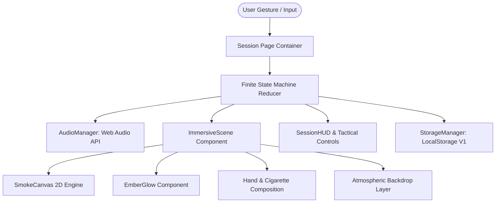
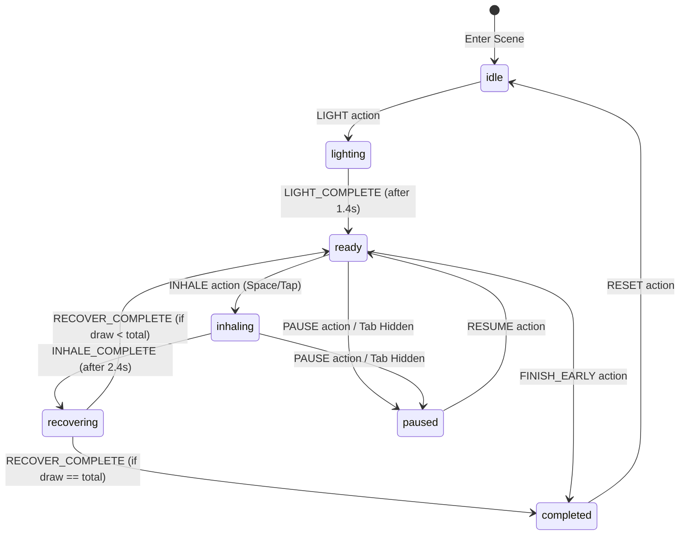

# System Architecture: Vesper Ritual

## 1. High-Level Architecture Overview

Vesper Ritual is structured as a client-side first, zero-backend web application built on Next.js 14 App Router. It combines declarative React components with imperative HTML5 Canvas rendering for fluid smoke particle physics and procedural Web Audio synthesis.



---

## 2. Finite State Machine (FSM)

The session lifecycle is governed by an explicit, pure reducer function in `src/features/session/sessionStateMachine.ts`.

### State Diagram


### Invariants & Guard Conditions
- **Input Locking**: While in `lighting`, `inhaling`, or `recovering`, duplicate click/tap actions are strictly no-ops to avoid state desync.
- **Draw Counter**: `currentDraw` only increments upon `RECOVER_COMPLETE`.
- **Visibility Protection**: When the document fires `visibilitychange` with `document.hidden = true`, the session automatically enters `paused`.

---

## 3. Visual Scene Layering & Composition

The first-person view uses depth layering:

1. **Layer 0 (Z-0)**: Deep atmospheric photo backdrop (`/assets/backgrounds/*.jpg`), scaled to 105% to allow subtle organic camera breathing motion via Framer Motion.
2. **Layer 1 (Z-10)**: Dynamic lighting tint overlay that blooms with ember color during inhalation.
3. **Layer 2 (Z-15)**: Foreground hand and cigarette (`/assets/foreground/hand-lit.jpg` and `hand-unlit.jpg`) aligned to the bottom-right viewport with `mix-blend-screen` and perspective translation.
4. **Layer 3 (Z-20)**: `SmokeCanvas` 2D particle simulation computing velocity, buoyancy, drag, turbulence, and alpha dissipation anchored to the ember tip.
5. **Layer 4 (Z-30)**: `EmberGlow` radial gradient flare and ignition flame effect.
6. **Layer 5 (Z-40)**: `SessionHUD` tactical controls and progress ticks.
7. **Layer 6 (Z-50)**: Completion modal / Pause overlay.

---

## 4. Web Audio Engine & Procedural Synthesis

Rather than relying on large, brittle external MP3 files that could fail to load, `AudioManager` uses procedural synthesis via the Web Audio API:
- **Lighter Click**: Square wave pitch drop (2400Hz → 300Hz in 40ms) + bandpass filtered white noise burst.
- **Inhale Draw**: Biquad bandpass filter sweeping from 320Hz to 750Hz with randomized Brownian crackle simulating leaf combustion.
- **Exhale Recovery**: Lowpass filtered pink noise fading out over 1.6s.
- **Ambient Soundscapes**: Continuous audio buffers generating generative rain on glass, night breeze, or terrace air.
- **Completion Chime**: Harmonic tri-tone sine chord (440Hz, 554.37Hz, 659.25Hz) with natural exponential decay.

---

## 5. Storage Architecture & Versioning

All state persistence is managed through `StorageManager` (`src/lib/storage/localStorage.ts`) with versioned Zod validation:

```typescript
interface StorageDataV1 {
  version: 1;
  baseline: UserBaseline;
  entries: Record<string, DailyLogEntry>; // YYYY-MM-DD
  preferences: UserPreferences;
}
```

- **Resilience**: If corrupted or outdated data is detected, the manager safely validates and patches defaults without crashing the app.
- **Reactivity**: Storage writes dispatch a custom window event (`vesper-storage-update`) allowing multi-tab synchronization.

---

## 6. Future Backend Integration (Supabase Ready)

The storage interface is intentionally decoupled. To introduce cloud synchronization in a future version:
1. Replace `StorageManager` calls with a Supabase client service.
2. Enable Row-Level Security (RLS) on `user_baseline` and `daily_logs` tables keyed by `auth.uid()`.
3. Support offline-first syncing via Service Workers.
